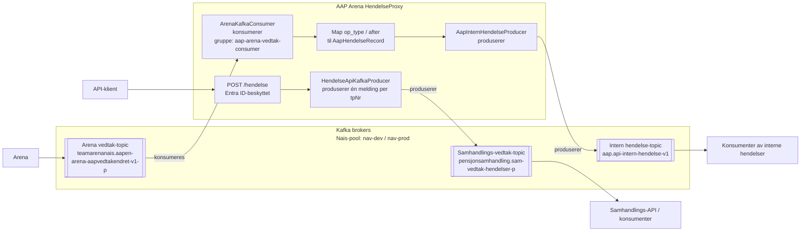

# aap-arena-hendelse-proxy

Applikasjon for å håndtere hendelser fra Arena som skal videre inn til felles samhandlingsApi.

## Informasjonsflyt for Kafka

Arena-konsumenten publiserer kun for hendelser som ikke er slettinger og har `after`-data. Den publiserer intern hendelse med personident som nøkkel, og committer
konsumert batch etter at alle meldingene er behandlet. API-flyten publiserer samhandlingshendelser med identifikator som
nøkkel og svarer `202 Accepted` etter publisering.

| Topic              | Dev                                               | Prod                                             |
|--------------------|---------------------------------------------------|--------------------------------------------------|
| Arena vedtak       | `teamarenanais.aapen-arena-aapvedtakendret-v1-q2` | `teamarenanais.aapen-arena-aapvedtakendret-v1-p` |
| Samhandlingsvedtak | `pensjonsamhandling.sam-vedtak-hendelser-q2`      | `pensjonsamhandling.sam-vedtak-hendelser-p`      |
| Intern hendelse    | `aap.api-intern-hendelse-v1`                      | `aap.api-intern-hendelse-v1`                     |

API-dokumentasjon her: https://aap-arena-hendelse-proxy.intern.dev.nav.no/swagger-ui/index.html

# Komme i gang

Bruker Gradle wrapper, så bare klon og kjør `./gradlew build`

# Henvendelser

Spørsmål knyttet til koden eller prosjektet kan stilles som issues her på GitHub

## For NAV-ansatte

Interne henvendelser kan sendes via Slack i kanalen #po-aap-team-aap.
